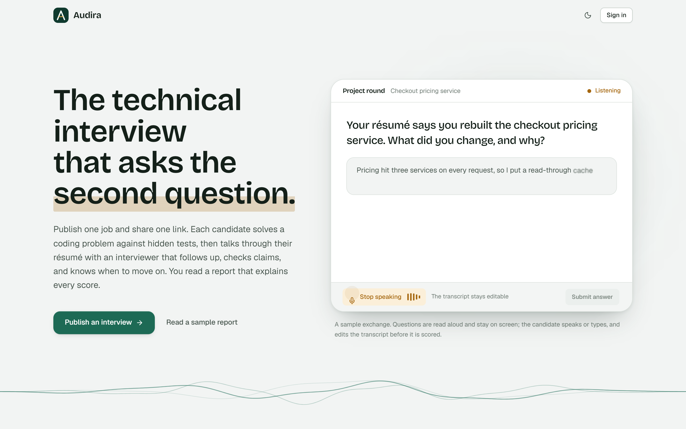
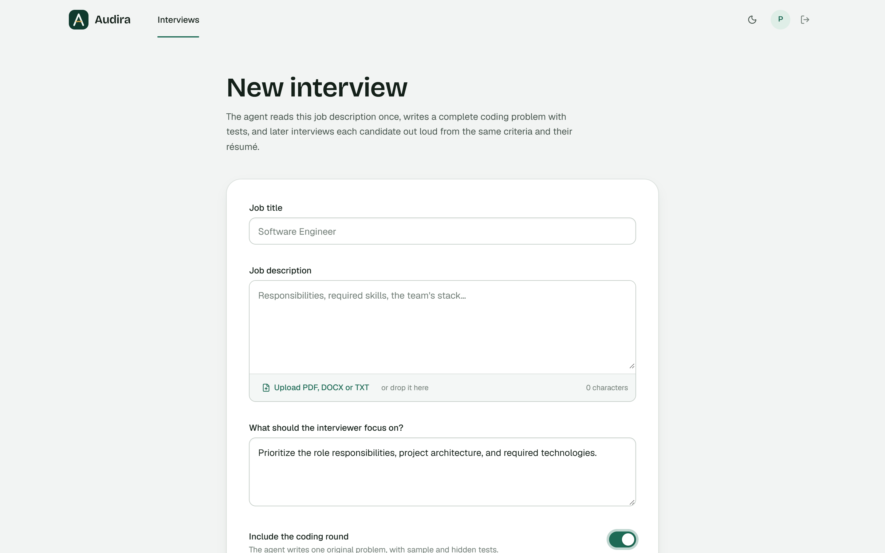
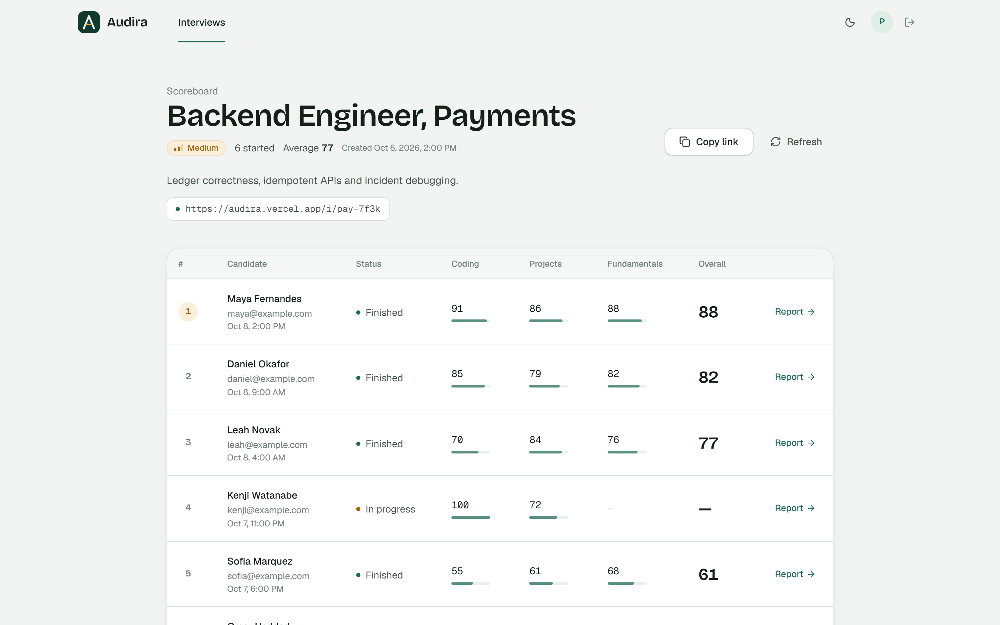
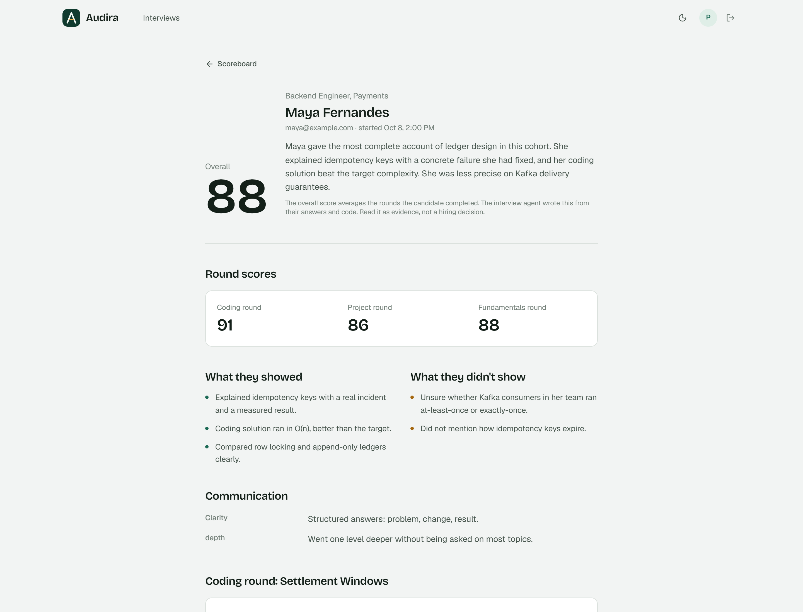
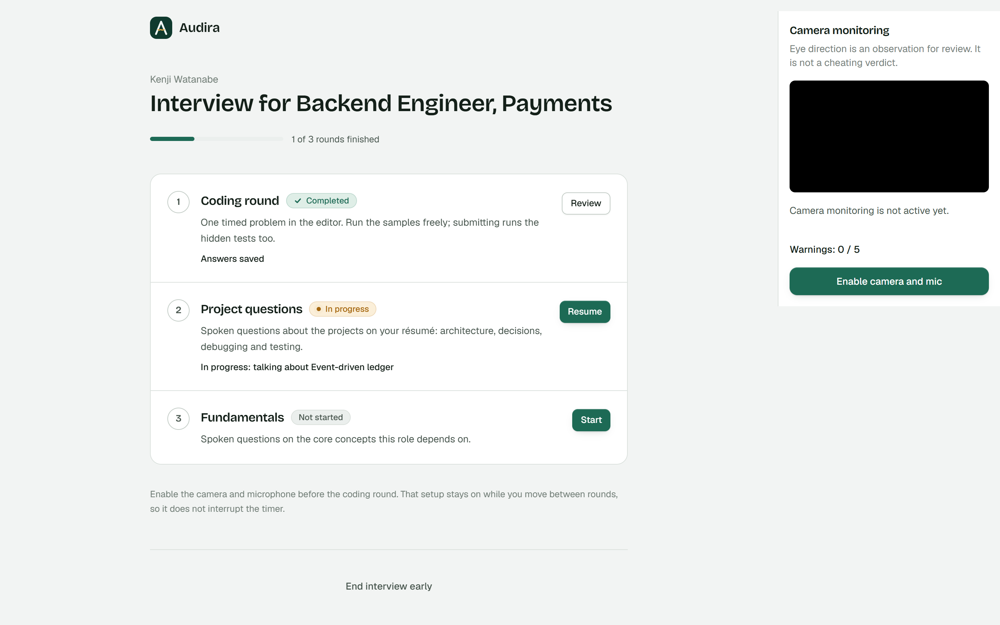
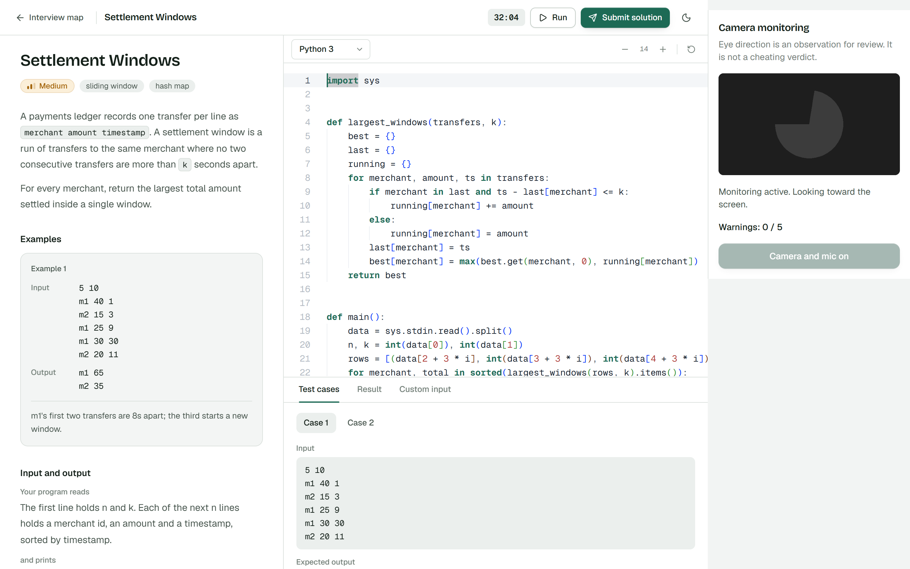

<div align="center">


# Audira

**The technical interview that listens.**

Publish one job, share one link, and get a clear, written report on every candidate.

[Live demo](https://audira.vercel.app) · [Run it locally](#run-it-locally) · [License](LICENSE)

<br />

<picture>
  <source media="(prefers-color-scheme: dark)" srcset=".github/assets/home-dark.png" />
  
</picture>

</div>

## What it is

Audira is an AI interviewer for technical hiring. A recruiter describes the role once. Every candidate who opens the link then gets an interview built around that job and their own résumé, and the recruiter reads a report that explains each score.

Each interview has three rounds:

- **Coding.** A timed problem written for the role, solved in a real code editor.
- **Projects.** A spoken conversation about what the candidate has built.
- **Fundamentals.** A spoken conversation about the core concepts the job depends on.

The interviewer doesn't just read from a list. It asks follow-up questions when an answer is vague, picks up on things the candidate mentions, and moves on when it has heard enough.

## For recruiters

Create an interview from a job description. You can paste it or upload a PDF, choose a difficulty, and decide which rounds to include.



Every interview gets one shareable link. Candidates are ranked on a scoreboard as they finish.



Each candidate gets a full report covering:
- their round scores
- what they showed and what they didn't
- notes on how they communicate
- the code they submitted
- questions worth asking in a follow-up interview

<picture>
  <source media="(prefers-color-scheme: dark)" srcset=".github/assets/report-dark.png" />
  
</picture>

## For candidates

Candidates can see their progress through the rounds and pick up where they left off.



The coding round has a proper editor in more than a dozen languages, sample tests to run, and a timer.



In the spoken rounds the questions are read aloud and stay on screen. Candidates answer out loud or by typing, and can edit the transcript before sending it.

## Fair by design

- **Evidence, not verdicts.** Every rating in a report points to what the candidate actually said or wrote.
- **Monitoring that respects people.** The camera checks run in the candidate's browser, and no video is uploaded. Anything unusual is recorded as an observation for a person to review, never as an accusation.
- **Scores stay with the recruiter.** Candidates never see their scores or the interviewer's private notes.

## Run it locally

You'll need [Python 3.13](https://www.python.org/) with [uv](https://docs.astral.sh/uv/), and [Node.js 20+](https://nodejs.org/).

```bash
# The API, from the repo root
uv sync
cp .env.example .env      # then add your keys
uv run main.py

# The web app, in a second terminal
cd frontend
npm install
npm run dev
```

Open [localhost:3000](http://localhost:3000), create an interviewer account with the `ADMIN_ACCESS_CODE` from your `.env`, publish a job, and open the link in a private window to take it as a candidate.

<details>
<summary>Environment variables</summary>

| Variable                         | What it's for                                        |
| -------------------------------- | ---------------------------------------------------- |
| `HUGGINGFACE_API_KEY`            | The interviewer (required)                           |
| `GEMINI_API_KEY`, `GROQ_API_KEY` | Backup providers if the main one is busy             |
| `CARTESIA_API_KEY`               | Spoken questions and live transcription              |
| `MONGODB_URI`                    | Where interviews are stored. Leave empty to keep them in memory |
| `ADMIN_ACCESS_CODE`              | Required to create an interviewer account            |

</details>

To run the tests:

```bash
uv run --with pytest pytest
```

## Built with

Next.js, FastAPI, MongoDB, Monaco, Judge0, and [Cartesia](https://cartesia.ai) for voice.

## License

[MIT](LICENSE)

<sub>The screenshots use sample data. The people and companies in them are made up.</sub>
